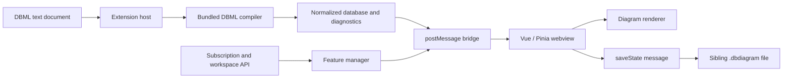

# Architecture and behavior

The extension has two application components: a Node extension host and a Vue webview. Both are shipped as large minified bundles with many dependencies included. There are no source maps referenced by the inspected entry bundles. Variable names are minified; class method names, property keys, event names, settings, and many strings remain readable.

## Startup

The manifest activates on startup or on opening the custom editor `dbdiagram.dbmlEditor`. Activation initializes the extension context, output channels, document diagnostics, feature manager, custom editor provider, authentication provider, and three commands. Document-open and document-change listeners reparse DBML. Document-close clears diagnostics. The provider retains webview context while hidden and permits multiple editors for a document.

Commands: `dbdiagram-vscode.showPreview`, `dbdiagram-vscode.generateFromConnection`, and `dbdiagram-vscode.loginToDbdiagram`. The preview command opens the custom editor beside the current DBML document. The connection wizard offers PostgreSQL, MySQL, MSSQL, and Snowflake in this build.

## Rendering path

The document processor parses DBML as `dbmlv2`, normalizes the resulting database, extracts diagram-view definitions, and converts compiler diagnostics into VS Code errors and webview errors. The webview receives an `update` message, updates its database store, synchronizes views, filters visible entities, and passes the filtered and full databases into the renderer.

The renderer receives feature flags, dark mode, grid state, detail level, relationship mode, table positions, collapsed groups, sticky-note layouts, reference paths, and view selection. It emits layout changes and user actions. View changes can produce text edits to DBML, which the host applies using a VS Code `WorkspaceEdit` and saves.

## Persistence

A sibling `.dbdiagram` file stores visual state. DBML stores schema, dependencies, notes, and view membership. This explains why opening one model creates a second file without the model author explicitly creating it. The state file is debounced for one second and flushed when the preview is disposed.

## Feature flow

A feature manager reads the VS Code authentication session, requests subscription/workspace metadata if signed in, selects a local feature profile, and broadcasts it. The webview stores the flags and passes them into renderer components. Some view operations and detail-level changes also have explicit guards in the webview wrapper.

## What recovery means here

The project extracts exact class/function expressions, records their offsets and hashes, and prints readable copies. It does not recover original TypeScript interfaces, original filenames, comments removed by compilation, server source code, or original non-minified local variable names. Formatting is reconstructed; behavior is measured through the included harnesses where indicated.
